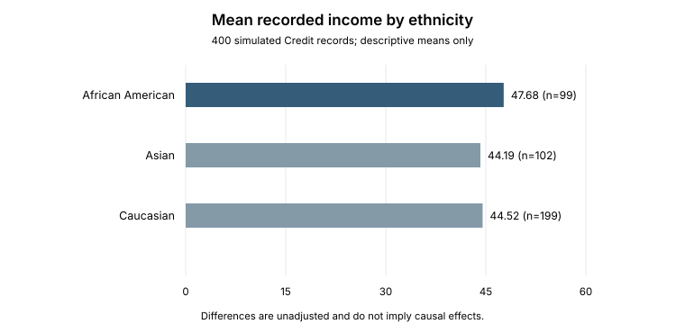
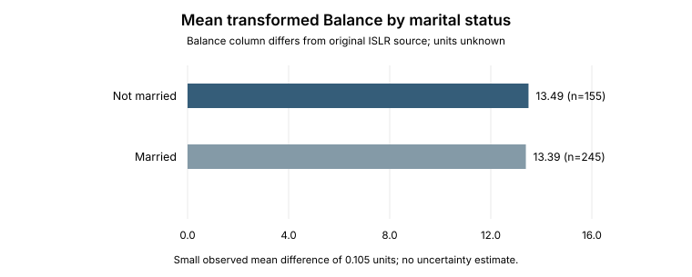

# Descriptive Credit Statistics and the Consequences of an Undocumented Balance Transformation

**A reproducible audit of group comparisons, data provenance, and apparent correlations**

**Amogelang R. Pelo**

## Abstract

I examine a pandas-based descriptive-statistics project using 400 credit-related records. The original task calculates income averages by ethnicity, balance averages by marital status, income extremes, total credit-card counts and counts by recorded gender. I independently reproduced those calculations from the project's space-delimited `balance.txt` file and identified an important provenance issue. The dataset matches all 400 observations of the simulated *Credit* dataset distributed with *An Introduction to Statistical Learning* on ten non-balance variables, but **every value in its `Balance` column differs** from the canonical source. The project does not explain how those balances were modified.

In the submitted file, mean recorded income is **45.2189**, with a minimum of **10.354** and maximum of **186.634**; the `Cards` column sums to **1,183**. Income averages are **47.6821** for the 99 records labelled African American, **44.1878** for the 102 records labelled Asian and **44.5219** for the 199 records labelled Caucasian. The transformed balance averages are **13.3885** for 245 married records and **13.4935** for 155 unmarried records. Most importantly, the altered balance has a Pearson correlation of **0.9654** with income, compared with **0.4637** for the canonical source balance. This substantial difference shows that an undocumented data change can alter apparent relationships even when the other fields remain intact.

I conclude that the project demonstrates group-wise calculation and summary-statistic methods, but its balance results must be presented as *source-file measurements of unknown units*, not original dollar balances or evidence about actual customers. The study illustrates why descriptive research requires provenance checks as well as correct code.

**Keywords:** descriptive statistics; credit data; data provenance; pandas; data transformation; income; group means; reproducibility.

## 1. Introduction

Descriptive statistics provide a foundation for understanding structured records. Counts indicate the size of a dataset or subgroup, means summarise numerical values, and minimum and maximum observations identify the endpoints of a recorded range. When these summaries are organised by a categorical variable, the analyst can describe differences between groups and generate questions for further investigation. Such calculations are straightforward to express in pandas, but their meaning depends on accurate source data and an explicit definition of each variable (Tukey, 1977).

The repository project examined in this paper was developed as a task in descriptive analysis. Its Jupyter notebook reads a file called `balance.txt` and asks six questions: how average income differs by ethnicity; whether married or unmarried people have a higher average balance; the income maximum and minimum; the total number of cards; and the number of female and male records. The notebook implements `groupby`, `mean`, `max`, `min`, `sum`, `value_counts` and `count` to answer these questions (Pelo, n.d.-a).

These operations are useful in business reporting. For instance, distinguishing the average number of cards per person from the total number of cards prevents a common interpretation error. Similarly, comparing average balances by status requires both the values and the number of observations behind each mean. Yet a correct calculation can still be misleading if a dataset contains an undocumented transformation or lacks a valid sampling frame.

The present research therefore asks two questions. First, **what descriptive results are reproducible from the provided file?** Second, **how does comparison with the standard simulated Credit dataset change the interpretation of those results?** I address the computational and evidential aspects separately. The exercise is not a credit-risk model, an investigation of actual borrowing behaviour or an assessment of any person's creditworthiness.

## 2. Background and statistical framework

### 2.1 Descriptive group means

An arithmetic mean is the sum of observed values divided by the number of nonmissing observations. If a categorical variable divides records into groups, the group mean is computed independently for each group. This is exactly the logic of a pandas call such as `df.groupby("Ethnicity")["Income"].mean()`.

Group size matters for interpretation. An average based on 199 records is supported by more observations than an average based on 99 records, but it is not necessarily more representative of a target population. Representativeness depends on how the observations were generated or sampled and whether the population of interest has been defined (OpenIntro, n.d.).

A group comparison is also not a causal estimate. A difference in means does not demonstrate that the grouping characteristic caused the difference. In a simulated dataset, this qualification is particularly strong: the recorded statistical relationships are properties of the simulation, not necessarily properties of real-world behaviour.

### 2.2 Counts, sums, extrema and denominators

Several operations can be confused if their targets are not specified. A `count()` applied to a nonmissing column measures the number of available records. A `sum()` of `Cards` measures the total number of cards across those records. Dividing the card total by 400 gives a *mean cards per record*, a separate statistic.

Likewise, a maximum and minimum describe observed endpoints. They cannot determine a population's highest or lowest possible value. Without a documented sampling mechanism, there is no defensible basis for assuming the observed range extends to an entire national credit market.

The project reports gender categories as recorded in the file. A frequency table says how many records carry those categories; it does not establish broader demographic coverage or identify every possible category outside the supplied dataset.

### 2.3 Correlation and conditional interpretation

Pearson's correlation coefficient measures the direction and strength of a linear association between two numeric variables, ranging from minus one to plus one. A coefficient near +1 means that higher values of one variable tend to be associated with higher values of the other under the observed linear relationship. It does not establish that one variable causally affects the other (James *et al.*, 2021).

Correlation is highly sensitive to the actual numerical values of its inputs. If one column is replaced with a different numerical quantity while the remaining columns are unchanged, the resulting correlations may differ substantially. A transparent study must identify whether such a replacement occurred before offering a substantive explanation.

It is essential to distinguish a *known mathematical transformation* from an *undocumented alteration*. A monotonic transformation can preserve ranks but still change Pearson correlation; replacing values according to an unknown formula makes broader interpretation even less secure. The source file does not document the mapping used to create its balance column.

### 2.4 Simulated credit observations

The original ISLR/ISLP *Credit* dataset is explicitly described as **simulated** and contains 400 observations. Its variables include income, credit limit, rating, number of cards, age, education, recorded gender, student status, marital status, ethnicity and the original average balance (James *et al.*, 2021; ISLP, n.d.).

This matters because a simulation can illustrate statistical methods without constituting a survey of actual customers. The matching fields suggest that the repository file was derived from that benchmark, but the changed balance values require special treatment. The study therefore does not portray the groups as respondents to a real contemporary credit survey.

## 3. Data, source verification and methods

### 3.1 Materials reviewed

I examined the original `credit_statistics.ipynb` notebook, its preserved copy, the repository README, and the accompanying `balance.txt` file. The original notebook contained a call to `pd.read_csv("balance.txt")` without a specified separator. That call treats a standard input file as comma-delimited, even though the supplied dataset is whitespace-delimited. The notebook has been corrected to use `sep=r"\s+"` while retaining a copy of the original for provenance (Pelo, n.d.-a; Pelo, n.d.-b).

I inspected the file format before calculating the statistics. Its header contains eleven quoted field names. Numeric records are separated by whitespace; categorical strings appear in quotes, including the multiword category `"African American"`. The CSV reader with the appropriate whitespace separator and default quote handling produces 400 rows and eleven columns in the tested parsing procedure (pandas development team, n.d.).

### 3.2 File dimensions and variable types

The project file includes seven numeric columns—`Balance`, `Income`, `Limit`, `Rating`, `Cards`, `Age` and `Education`—and four categorical columns—`Gender`, `Student`, `Married` and `Ethnicity`.

| Data property | Verified result | Why it matters |
|:--|--:|:--|
| Data rows | 400 | Defines denominators |
| Data columns | 11 | Seven numeric and four categorical variables |
| Distinct listed ethnicity groups | 3 | Group means require group counts |
| Listed gender groups | 2 | Frequencies apply only to recorded categories |
| Sum of `Cards` | 1,183 | Total count, not mean |
| Mean of `Cards` | 2.9575 | Cards per record |
| Income minimum | 10.354 | Observed lower endpoint |
| Income maximum | 186.634 | Observed upper endpoint |

I identified no row-parsing failures when treating quotes and whitespace as intended. The dataset's dates, sampling procedure and any transformation applied to `Balance` are not described in the assignment files. That absence affects external interpretation even when the computational summary is reproducible.

### 3.3 Comparison with the published Credit dataset

I compared the 400 repository observations with the CSV maintained by the official *Introduction to Statistical Learning with Python* (ISLP) project. The comparison used row position and the ten non-balance variables, normalising incidental whitespace in strings and allowing floating-point serialisation differences smaller than a conventional numerical tolerance.

**All 400 rows matched on all ten non-balance fields.** This includes categorical variables and numeric variables such as income, cards and credit limit. The published version also includes an `ID` column absent from the repository file.

The balance fields do **not** match. All 400 entries in the repository's `Balance` column differ from their corresponding entries in the official dataset. For example, the first five original balance values are 333, 903, 580, 964 and 331, whereas the portfolio file contains approximately 12.2408, 23.2833, 22.5304, 27.6528 and 16.8940 in those same rows.

The project supplies no formula explaining the alteration. I therefore call the current field *modified balance* or *project balance*, with units unspecified, rather than asserting that the values are original US-dollar balances. The exact comparison and examples are recorded separately in [`DATA_PROVENANCE.md`](DATA_PROVENANCE.md).

### 3.4 Descriptive calculations

I calculated arithmetic means for income by ethnicity and modified balance by marital status. I also calculated income minimum, maximum, mean and standard deviation, the card total, category frequencies and selected Pearson correlations. For provenance analysis, I calculated income–balance correlations using both the project column and the independently retrieved original balance column.

These additional comparisons extend the original educational notebook. They are not presented as claims that the notebook originally performed correlation analysis or provenance matching. Keeping the original task and the audit separate allows a reader to identify what the student initially implemented and what was subsequently verified.

## 4. Results: overall descriptive profile

### 4.1 Income range and central tendency

The recorded income values range from **10.354** to **186.634**, with an arithmetic mean of **45.2189** and a sample standard deviation of **35.2443**. The mean is closer to the lower end of the range, indicating that some larger observations pull the average upward relative to the many smaller values.

The ISLR source describes the income field in thousands of US dollars. Because the 400 values match this original field row by row, that source definition can reasonably be used when discussing `Income` specifically. It does not follow that every field, especially the modified `Balance`, retains its original source unit.

A range is not a statement about the distribution's shape. Descriptive research could be expanded using the median, quartiles and a histogram to identify skewness and compare summaries robust to extremes. The current project task centres on minimum, maximum and group means.

### 4.2 Cards and category counts

The sum of `Cards` is **1,183** across 400 observations. Dividing by the record count yields **2.9575 cards per record**. These two values answer different questions. The first is the total number of reported cards; the second is a per-record average.

There are **207 records labelled Female** and **193 labelled Male**. The two counts sum to 400. This establishes the composition of the provided data, not the distribution of gender in an identified credit-card market.

There are also **245 married records** and **155 unmarried records**, and **40 student records** versus **360 non-student records**. The source dataset is simulated, so these category frequencies should be interpreted as the structure of the benchmark rather than survey estimates.

### 4.3 Modified balance range and average

The portfolio file's `Balance` column ranges from approximately **3.7494** to **38.7851** and has an average of **13.4292**. The canonical `Credit` dataset instead has original balance values ranging from **0 to 1,999**, with a mean of **520.015**.

This disparity is not a trivial change of displayed decimal places. Without the generating formula, the numerical meaning of the modified balance column is unresolved. The source's original dollar unit should not be transferred to it. In particular, interpreting a mean of 13.4292 as **$13.43 in average debt** would be unjustified.

## 5. Results: grouped comparisons

### 5.1 Income by recorded ethnicity

The original notebook asks for income grouped by `Ethnicity`. I reproduced that calculation and retained the denominator for each group.

| Dataset category | Number of records | Mean income |
|:--|--:|--:|
| African American | 99 | 47.6821 |
| Asian | 102 | 44.1878 |
| Caucasian | 199 | 44.5219 |
| **All records** | **400** | **45.2189** |

<figure class="chart wide"><figcaption>Figure 1. Arithmetic mean income by recorded ethnicity in the simulated dataset. Means are unadjusted; categories and counts are those in the supplied file.</figcaption></figure>

The highest recorded group mean is 47.6821 for African American records and the lowest is 44.1878 for Asian records, a difference of approximately **3.4943** in the income field's units. The Caucasian group has the largest number of records, but its mean is not the highest.

This is a statement about the simulated values, not evidence of real ethnic income inequality. The source is not a representative survey, the group composition may have been generated by assumptions in the simulation, and no adjustment is made for other recorded features. Any claim about causes of income differences would exceed the data and the assignment design.

### 5.2 Modified balance by marital status

The original notebook also asks whether married or unmarried people have a higher mean `Balance`. On the *modified values supplied in the portfolio file*, the answer is that the unmarried group has a slightly higher arithmetic mean.

| Recorded marital status | Number of records | Mean modified balance |
|:--|--:|--:|
| Married: No | 155 | 13.4935 |
| Married: Yes | 245 | 13.3885 |
| Overall | 400 | 13.4292 |

<figure class="chart wide"><figcaption>Figure 2. Mean project balance by marital status. The chart uses a zero-based axis to avoid exaggerating the very small difference; balance units are unidentified.</figcaption></figure>

The difference is approximately **0.1050 modified-balance units**, with married records having the lower mean. Without an estimate of group variability or a documented balance transformation, this small gap should not be interpreted as economically important.

The canonical source also has a relatively small gap: mean original balance is approximately **523.29** for unmarried records and **517.94** for married records. But those are on a different scale and represent a different numerical field. Their similar ordering does not establish that the transformation is valid or that the two analyses are interchangeable.

### 5.3 Student and gender balances as secondary descriptions

As an additional check, the project balance mean is approximately **14.3826** among the 40 student records and **13.3232** among the 360 non-student records. The gender-group means are approximately **13.4140** for female records and **13.4454** for male records.

These checks illustrate how readily a dataframe can produce many group comparisons. They also show why a research question and interpretation rules matter. Generating additional differences by slicing categories does not mean each difference is meaningful, stable or causal. Without adjustment, uncertainty estimates or a representative sample, it is inappropriate to draw behavioural or policy conclusions from such marginal summaries.

## 6. Data-provenance finding: an apparent correlation changes substantially

### 6.1 Income and modified balance

I calculated the Pearson correlation between income and the **modified project balance** as approximately **+0.9654**. This is an extremely strong positive linear association within the 400 supplied records. If the file were analysed without comparing source lineage, an analyst might mistakenly conclude that income almost determines the recorded balance.

However, the official source balance yields a substantially lower income correlation of approximately **+0.4637** for the same ordered 400 records. The correlation between the original balance and the modified balance is approximately **+0.4602**. All three figures were computed from the two files during the audit.

| Comparison | Pearson correlation |
|:--|--:|
| Income versus project modified balance | +0.9654 |
| Income versus original ISLP balance | +0.4637 |
| Modified versus original balance | +0.4602 |

This is the most important substantive finding of the portfolio audit: **the altered dependent variable changes the apparent relationship with income**, even though the other ten source variables remain effectively identical. A model trained to predict the project balance would therefore be studying a different numerical target from a model trained to predict the original source balance.

### 6.2 Why this matters for financial research

A correlation near +0.97 can tempt an analyst to claim a near-deterministic relationship. Such a claim would be inappropriate here. The relationship may reflect how the modified balance values were constructed rather than an economic association between independently recorded quantities.

Since the transformation is unknown, I cannot determine whether it used income, another source field, a rescaling formula, random values or a more complex process. I therefore do not infer *how* the correlation was generated. The evidential result is narrower: the project variable differs from the original for every observation, and its statistical relationships differ materially.

This is also a caution for machine-learning work. If a target variable is changed without documentation, a model can look extraordinarily strong while no longer answering the intended practical question. Clear target definitions, immutable raw data and a transformation log are necessary for auditability.

### 6.3 The relationship to the original task

The original notebook's main requests concern grouped means and simple counts, not supervised modelling. Those requests can still be fulfilled on the project file if the output is labelled correctly. A group mean is arithmetically valid for the values provided even when the units are not fully known.

What changes is the **scope of interpretation**. Rather than describing measured average credit-card balances in US dollars, the results describe an unidentified numeric field called `Balance` in the particular teaching file. For general statistical practice, the exercise remains useful. For substantive financial claims, the transformation is a material limitation.

## 7. Methodological evaluation

### 7.1 Correct data loading is the first control

The original input was not a conventional comma-separated file. It used whitespace separators and quoted categories. The notebook was updated to use:

```python
import pandas as pd
df = pd.read_csv("balance.txt", sep=r"\s+")
assert df.shape == (400, 11)
```

The corrected reading logic preserves the intended eleven columns, including multiword values such as `African American`. The original notebook was retained in the repository under a separate filename. This keeps a record of what the initial submission contained while allowing the portfolio version to run against the actual supplied file.

The shape assertion is a basic validation check. It cannot prove that every numerical value is correct, but it catches failures such as reading the whole line into one column or accidentally loading a truncated file.

### 7.2 Counts and denominators

Every grouped statistic should state its denominator. Means from records of different group sizes should not be compared as though each group contained the same number of observations. Similarly, the number of available female and male categories should be counted directly rather than inferred from the total dataset size.

A robust pandas pipeline would also use `isna().sum()` to record missing values and check whether any nonnumeric strings were unexpectedly introduced into numeric fields. The data file as parsed during this audit contained 400 complete records in the intended columns.

### 7.3 Separation of raw data and derived information

The most important proposed improvement is a simple data-lineage structure. An immutable copy of the source input should be preserved; any transformation should be implemented in a separate script or notebook cell; and outputs should be saved with metadata documenting their units and input version.

For example, if `Balance` had been scaled or engineered intentionally, an analyst should record the exact formula and its parameters and state whether it can be inverted to the original dollar amount. Without that information, the field should remain explicitly marked as modified or unknown.

The audit's [provenance note](DATA_PROVENANCE.md) therefore links the benchmark source, identifies matching and changed columns and reports sample values from each file. This does not recover the unknown transformation, but it prevents downstream researchers from silently assuming the values are original.

### 7.4 Inferential limitations

No statistical hypothesis test, standard error, confidence interval or multivariable adjustment was part of the notebook's original outputs. These omissions are not errors in a basic descriptive assignment. They do, however, limit how strongly one can interpret the differences.

If a subsequent research question involved whether marital status is associated with balance after controlling for income, credit limits and student status, a new design would be needed. It would also have to decide whether the intended outcome is the original simulated dollar balance or the altered portfolio field, because those are different variables in practice.

With simulated data, even a highly precise p-value would not make conclusions representative of a real country or lending institution. Statistical inference and substantive validity are distinct requirements.

## 8. Reproducibility, limitations and further work

### 8.1 Reproducible calculation expressions

The following pandas operations describe the original task's analytical logic and produce the primary summaries when executed after corrected loading:

```python
mean_income_by_ethnicity = df.groupby("Ethnicity")["Income"].mean()
mean_balance_by_marriage = df.groupby("Married")["Balance"].mean()
income_maximum = df["Income"].max()
income_minimum = df["Income"].min()
total_cards = df["Cards"].sum()
gender_counts = df["Gender"].value_counts()
income_balance_correlation = df["Income"].corr(df["Balance"])
```

The correlation is an audit extension, not part of the original task. A reproducible comparison with the official ISLP dataset should match the ten unchanged variables, document tolerance for numerical serialization and compare the modified balance against the original balance separately.

### 8.2 Limitations of the present paper

The study is based on a supplied teaching file and a public simulated benchmark. It has no documented date, real-world sampling mechanism or description of the modified balance transformation. The balance calculations are correct for the provided numeric values but cannot be assigned the original source's dollar meaning without additional documentation.

The supplementary correlation comparisons are deterministic descriptive properties of the two 400-row files. They are not causal estimates and do not establish who changed the balance column or why. The report has not estimated formal uncertainty around subgroup means, nor has it tested a credit-risk or default-prediction system.

### 8.3 Recommended next steps

A further project could reconstruct or identify the balance transformation by locating the exact source assignment or processing script. Once the formula is established, the analyst should document input and output units, confirm whether the process is invertible and add tests checking that a known original balance produces the expected modified value.

An improved research version could compare original and modified datasets under the same exploratory plots and fit clearly labelled descriptive regressions to show how target engineering changes coefficients and R². Those models should be presented as *separate experiments* and should not be asserted to have already been performed by the original notebook.

A small reusable validation script could also compare observed row and column counts with expected values, check nonmissingness, verify category names and compute checksums. Together, these controls would make future portfolio additions more resistant to silent data errors.

## 9. Conclusion

I find that the credit-statistics task demonstrates useful proficiency with grouped descriptive calculations in pandas. The provided dataset contains 400 records, a total of 1,183 cards, an income range of 10.354 to 186.634 and a mean income of approximately 45.2189. Its category-level summaries can be reproduced directly once the whitespace-delimited file is loaded correctly.

The source audit changes how the balance results must be understood. Although the dataset closely matches the standard simulated *Credit* records, every balance value has been altered. The income correlation changes from approximately **0.4637** with the original balance to **0.9654** with the modified field. That change is sufficiently large that original-dollar interpretations and substantive credit claims would be misleading.

My conclusion is that **a statistically correct summary is only as defensible as its data definitions**. The project has value as an educational exercise and as a practical example of why analysts should inspect source formats, preserve originals and identify transformations before drawing business conclusions. Future work should establish the exact balance transformation and clearly separate simulated educational results from real-world financial evidence.

## References

Agresti, A. (2013) *Categorical Data Analysis*. 3rd edn. Hoboken, NJ: Wiley.

ISLP (n.d.) *Credit Card Balance Data*. *Introduction to Statistical Learning with Python*: dataset documentation. Available at: https://islp.readthedocs.io/en/latest/datasets/Credit.html.

ISLP (n.d.) *Credit.csv: project source data*. GitHub, intro-stat-learning/ISLP. Available at: https://github.com/intro-stat-learning/ISLP/blob/main/ISLP/data/Credit.csv.

James, G., Witten, D., Hastie, T. and Tibshirani, R. (2021) *An Introduction to Statistical Learning: With Applications in R*. 2nd edn. New York: Springer.

OpenIntro (n.d.) *Introduction to Modern Statistics*. Available at: https://www.openintro.org/book/ims/.

pandas development team (n.d.) *pandas.read_csv documentation*. Available at: https://pandas.pydata.org/docs/reference/api/pandas.read_csv.html.

Pelo, A.R. (n.d.-a) *Credit records statistical profiling: corrected notebook*. GitHub portfolio. Available at: https://github.com/amopelo-southafrica/Mathematics-and-Statistics/blob/main/credit-records-statistical-profiling/credit_statistics.ipynb.

Pelo, A.R. (n.d.-b) *Credit statistics: preserved original notebook*. GitHub portfolio. Available at: https://github.com/amopelo-southafrica/Mathematics-and-Statistics/blob/main/credit-records-statistical-profiling/credit_statistics_original.ipynb.

Pelo, A.R. (n.d.-c) *balance.txt and data-provenance audit*. GitHub portfolio. Available at: https://github.com/amopelo-southafrica/Mathematics-and-Statistics/tree/main/credit-records-statistical-profiling.

Tukey, J.W. (1977) *Exploratory Data Analysis*. Reading, MA: Addison-Wesley.
