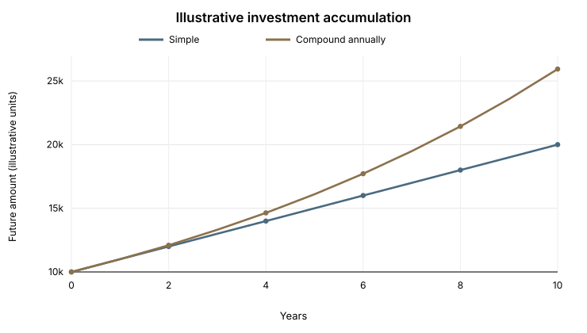

# Financial Mathematics in an Investment and Bond Calculator

**A source-code analysis of interest accumulation and amortising payments**

**Amogelang R. Pelo**

## Abstract

This paper evaluates a Python command-line project that calculates investment accumulation under simple or compound interest and estimates a fixed monthly bond repayment. I examine the original implementation, derive the financial mathematics underlying its formulas and use independently calculated examples to assess numerical behaviour and important edge cases. The investment section applies the standard simple-interest amount equation and an annual-compounding future-value equation. The bond section applies the conventional amortising-payment formula using the entered annual rate divided by twelve and an entered term in months (Pelo, n.d.; OpenStax, n.d.-a).

For an illustrative initial amount of 10,000 units, a 10% annual rate and five years, the simple-interest result is 15,000.00 and the annually compounded result is 16,105.10. For a separate illustrative loan of 1,000,000 units, a 12% annual nominal rate and 240 payments, the fixed principal-and-interest payment is approximately 11,010.86 units per month. These examples are calculations performed for this paper, **not saved outputs from the interactive program**.

Static inspection identifies input-validation gaps, a Boolean-expression error that limits accepted interest-type phrases and a zero-rate case that divides by zero in the bond formula. I conclude that the project effectively demonstrates financial mathematics and procedural coding, but needs explicit assumptions and systematic testing before it could support dependable real-world decisions.

**Keywords:** simple interest; compound interest; amortisation; fixed-rate payments; Python; numerical verification; financial software.

## 1. Introduction

A financial calculator is a small software system built around several consequential distinctions: an amount invested is not the same as interest earned, an annual percentage rate is not a monthly rate, and a monthly repayment is not the same as total borrowing cost. The underlying mathematics is relatively compact, yet an incorrect unit conversion or unhandled input can materially change a displayed result. For that reason, basic financial calculators are useful educational projects at the intersection of mathematics and software engineering.

The examined source file, `finance_calculators.py`, presents two choices: an **investment** calculator and a **bond** calculator. In the investment branch, the user enters principal, an interest rate and a number of years before selecting simple or compound interest. In the bond branch, the user enters a house value, an interest rate and a number of months, and receives a fixed-payment estimate (Pelo, n.d.).

My research question is: **How faithfully does this implementation translate elementary interest and amortisation formulas into a user-facing calculation, and what conditions limit the reliability of its results?** I answer through static review of the source, mathematical derivation, and independently verified numerical cases. The scope is the code as provided; I do not claim to have measured usability, tested real loan products or run a complete automated test suite.

This distinction is essential because technically correct formulas can still yield misleading outputs when user inputs are undefined, unit assumptions are concealed or errors are not handled. The purpose of the study is not to market a financial product. It is to evaluate the mathematics and implementation as an educational artefact and identify a disciplined path to stronger validation.

## 2. Financial mathematics and conceptual framework

### 2.1 Simple interest

Simple interest is calculated on the original principal only. If `P` denotes principal, `r` is the annual interest rate expressed as a decimal and `t` is the number of years, the future amount is

**A_simple = P(1 + rt).**

The interest earned is **I_simple = Prt**, and the future amount includes both the original principal and that interest. The script implements the amount formula as `principal_amount * (1 + (expected_return/100) * total_years)`. This is mathematically consistent with an entered annual rate expressed as a percentage and a duration in years (OpenStax, n.d.-a; Pelo, n.d.).

The formula assumes that interest is not added to the principal for subsequent interest calculations. For a nonnegative rate and duration, the accumulated amount grows linearly with time. It does not model periodic contributions, withdrawals, tax, fees, inflation or a changing rate.

### 2.2 Compound interest

Compound interest credits interest to the accumulated balance, so subsequent periods earn interest on previous interest. Under annual compounding at a fixed decimal rate `r`, the future amount is

**A_compound = P(1 + r)^t.**

The script implements this through `principal_amount * math.pow(1 + expected_return/100, total_years)`, using the number of years directly as the exponent. Therefore, although the program asks about compound interest generally, it specifically assumes **one compounding period per year**. A monthly-compounding product would require a different exponent and periodic rate (OpenStax, n.d.-b).

Compound growth depends on three parameters: the starting amount, rate and horizon. Any interpretation of the output needs to preserve these assumptions. It would be incorrect to describe the compound result as an annual percentage yield for an arbitrary interest product without knowing how that product actually credits interest.

### 2.3 Amortising loan repayments

A conventional fixed-rate fully amortising loan repays principal and interest through equal periodic instalments. Under a nominal annual rate `R`, the monthly rate is `i = R/12` when `R` is a decimal. For principal `P` and `n` monthly payments, the standard payment formula is

**M = Pi / [1 − (1+i)^(-n)]**, for `i ≠ 0`.

The result `M` is a **per-month principal-and-interest payment**, not the total amount repaid. The total of nominal payments would be `nM`, and total nominal interest under the simplified assumptions would be `nM − P`. The share of each instalment allocated to interest versus principal changes over the term even though `M` stays constant (OpenStax, n.d.-c; Consumer Financial Protection Bureau, n.d.).

The source converts the entered percentage to a monthly decimal through `interest_rate = float(input(...))/100/12` and then applies the formula. This is correct for the stated **nominal annual rate with monthly payments**, provided the period count is positive and the rate is nonzero. The program does not separately account for deposits, loan fees, insurance, property charges, a variable interest rate or prepayments.

### 2.4 Numerical and software validity

Mathematical validity and software validity are distinct. The annuity formula may be correct, while the program can still fail for a valid zero-interest loan, accept a negative term or misread a textual choice. Likewise, a displayed amount may be numerically plausible but poorly labelled. Software quality therefore requires both formula verification and tests of boundary inputs, error messages and user interpretation (Sommerville, 2016).

## 3. Research design and implementation review

### 3.1 Source inspected

The project folder contains a README and one Python script, `finance_calculators.py`. The README describes interest accumulation and loan payment estimation and notes that the investment selector expects the single words `simple` or `compound`, while the bond calculation assumes a nonzero interest rate. These observations are consistent with the source code (Pelo, n.d.).

| Component | Inputs | Computed result |
|:--|:--|:--|
| Simple investment | Principal, percentage rate, years | Future amount under linear accumulation |
| Compound investment | Principal, percentage rate, years | Future amount under annual compounding |
| Bond repayment | Loan value, percentage rate, months | Fixed monthly principal-and-interest payment |
| User interface | Name and selected calculation | Printed terminal message |

The name field is used to personalise some outputs but does not enter the formulas. There is no persistent database, graphical user interface, external market-data feed or model trained on financial observations. This is a deterministic rules-based program.

### 3.2 Static and quantitative assessment method

I traced the main menu, input conversions, branches and arithmetic expressions. I then tested the *mathematical equations independently*, using declared sample values that are not presented as observed user inputs or original program execution logs. This permits evaluation of what the program should calculate for valid inputs while keeping source-code behaviour separate from computed examples.

I also examined cases in which the formulas or branches could fail, including zero rates, zero payment periods, negative values, unrecognised input phrases and nonnumeric entries. This is a static assessment: cases identified as potential exceptions or logical defects are derived from the code paths, not claimed as measured incident frequencies.

### 3.3 Assumptions recorded

All worked examples use arbitrary monetary **units**, not a specified national currency. The script does not impose a currency or include exchange conversion. Investment rates are interpreted as fixed annual percentages. Bond rates are interpreted as fixed nominal annual percentages converted to monthly rates. No claims about current market rates, product availability or the suitability of any investment are made.

A reproducible financial software report should state these assumptions beside the values, because the same numeric interest rate can imply different accumulated amounts when compounded annually rather than monthly, or when interpreted as nominal rather than effective.

## 4. Worked results and numerical interpretation

### 4.1 Simple versus compound accumulation

For an independently calculated example, I select a principal of 10,000 units, an annual rate of 10% and a five-year holding period. The simple-interest equation gives `10,000 × (1 + 0.10 × 5) = 15,000.00`. The annual-compounding equation gives `10,000 × 1.10^5 = 16,105.10`.

| Quantity | Simple interest | Annual compound interest |
|:--|--:|--:|
| Initial principal | 10,000.00 | 10,000.00 |
| Annual rate | 10% | 10% |
| Holding period | 5 years | 5 years |
| Ending amount | 15,000.00 | 16,105.10 |
| Interest above principal | 5,000.00 | 6,105.10 |

The difference in ending amount is **1,105.10 units** in favour of compounding under these illustrative conditions. This is a mathematical effect of earning interest on prior interest; it is not a forecast of an actual investment return.

<figure class="chart wide"><figcaption>Figure 1. Simple and annually compounded accumulation from a 10,000-unit principal at an illustrative fixed 10% annual rate. Curves are calculated from the stated equations rather than drawn from investment-market observations.</figcaption></figure>

The gap widens as the horizon increases, because simple interest follows a straight line while compound interest follows an exponential path. At time zero both formulas return the starting principal. This is a useful consistency check: if a future-value formula did not reproduce `P` when `t = 0`, its implementation or interpretation would be suspect.

### 4.2 Fixed bond repayment

For a separate illustrative loan, I use a principal of 1,000,000 units, a **12% nominal annual interest rate** and 240 monthly payments. The corresponding monthly rate is 0.01. Substitution into the amortising formula yields a monthly payment of approximately **11,010.86 units**.

| Bond quantity | Independently calculated example |
|:--|--:|
| Principal | 1,000,000.00 units |
| Nominal annual interest rate | 12% |
| Monthly interest rate | 1% |
| Term | 240 months |
| Monthly principal-and-interest payment | 11,010.86 units |
| Total of 240 unrounded payments | 2,642,606.72 units |
| Interest component of total | 1,642,606.72 units |

The large difference between total paid and original principal illustrates how the repayment horizon and financing rate influence total cost. It should not be confused with a statement that a particular bank would charge this amount. A real agreement may include additional fees, insurance, taxes or rate changes.

The source uses the phrase “present value of the house” as the input label. In lending analysis, however, **the loan principal** may be lower than the property's price if a borrower makes a deposit. A calculator intended for real borrowers should identify and request the amount financed, or separately capture purchase price and deposit before estimating repayment.

### 4.3 Limiting behaviour

Two limiting cases help establish whether a financial formula has been implemented completely. First, if the annual interest rate is zero, a valid fixed-payment loan should repay only its principal: **M = P/n**, provided `n` is positive. The original bond formula, however, evaluates `0 / (1 − 1)`, which is undefined and causes a division-by-zero failure in Python. This is an important missing branch, not a defect in the general amortisation formula.

Second, if the principal is zero, an ordinary repayment formula should yield zero for valid terms, while a zero-month loan is not a defined repayment schedule. The program should reject a nonpositive number of payments explicitly. The same principle applies to negative investment years or principal values that the exercise does not intend to support.

## 5. Source-level findings and validation gaps

### 5.1 Text-choice logic

The script checks `if type_of_interest in ["simple" or "simple interest"]` and similarly for `"compound" or "compound interest"`. In Python, the `or` operator returns its first truthy operand, so each list expression evaluates to a **single-word list**: `["simple"]` or `["compound"]`. Therefore the apparent alternative phrases `simple interest` and `compound interest` are not accepted by these conditions.

The correct structure would use distinct elements, such as `["simple", "simple interest"]`. A more robust implementation could normalise `input().strip().lower()` and present a clear re-prompt when the value is unrecognised. This finding is visible directly in the source and does not depend on a financial assumption.

### 5.2 Input and error handling

The program converts investment amounts and rates directly through `float(...)` and years and months through `int(...)`. A nonnumeric input can therefore raise a conversion exception rather than produce a controlled message. There is no explicit check for a strictly positive term, a nonnegative principal or finite numeric values.

Input validation matters particularly in a financial context: the program should distinguish a mathematical domain restriction from a user typo. A zero interest rate is not automatically an invalid financial scenario, whereas a zero-length amortisation term generally is. Treating them as equivalent errors would be a design mistake.

### 5.3 Output terminology and transparency

The investment branch prints “expected return” for the full future amount. In financial usage, “return” may refer to earnings alone or to a percentage rate, while the formula computes **principal plus accumulated interest**. I would label the value “future amount” and show interest earned separately.

The bond branch describes “bond repayments after [months]” but prints the monthly payment. A clearer interface would label the result “estimated monthly principal-and-interest payment” and, if useful, show the simplified total repayment. The interface should explicitly state the assumed rate convention and that fees or other obligations are excluded.

### 5.4 Proposed test cases

A practical validation suite could establish the following expectations before the program is extended. These are **recommended acceptance tests**, not tests reported as executed in the original source project.

| Scenario | Expected behaviour |
|:--|:--|
| Principal 10,000; rate 10%; term 5; simple | Future amount 15,000.00 |
| Principal 10,000; rate 10%; term 5; compound | Future amount 16,105.10 |
| Loan 1,000,000; 12% nominal; 240 months | Monthly payment about 11,010.86 |
| Loan 1,000,000; 0%; 240 months | Monthly payment about 4,166.67 |
| “compound interest” as text | Recognised after correcting choice logic |
| Zero payment months | Rejected with explanatory message |
| Nonnumeric amount | Re-prompted without termination |
| Principal 0 under valid period | Coherent zero result or documented rejection |

I would use automated tests with numerical tolerances, rather than compare formatted strings character by character. The calculations involve binary floating-point values, which can differ slightly in their low-order digits; presentation should round for display without confusing display precision with numerical validity (Python Software Foundation, n.d.).

## 6. Critical discussion

### 6.1 What the project demonstrates

The program demonstrates the translation of mathematical expressions into executable code, the use of branches for different financial questions, typed input conversion and direct terminal output. It represents a useful early stage of mathematical programming. The investment and bond calculations are recognisably connected to established formulas, and the formulas can be checked independently.

However, a calculator becomes dependable only when its valid domain is well specified and its edge cases are handled systematically. A correct result for one ordinary input cannot stand in for a robust input contract. The difference is particularly visible in the bond branch, where the standard nonzero-rate formula works but the economically meaningful zero-rate case does not.

### 6.2 Financial interpretation and risk

Real loan pricing depends on contractual details that the script does not incorporate. A typical fixed-rate mortgage payment calculation can accurately estimate scheduled principal and interest under its assumptions, while still omitting fees, insurance and taxes. Consumer guidance makes this distinction when describing what a mortgage payment does and does not include (Consumer Financial Protection Bureau, n.d.).

Similarly, a constant positive investment rate is a mathematical input rather than a guarantee of earned performance. When illustrating future amounts, the calculator should distinguish hypothetical interest accumulation from market forecasts. Its outputs are educational calculations, not assessments of investment suitability or borrowing capacity.

### 6.3 Improvement priorities

I would prioritise changes in this order. First, correct the interest-choice conditions and add input normalisation. Second, validate numeric inputs, including nonnegative principal, admissible interest rates, and positive periods. Third, implement the zero-interest loan branch `P/n` and clarify output labels. Fourth, isolate the calculations as pure functions that can be unit-tested without terminal interaction. Finally, add a concise record of each formula's rate and compounding assumptions.

A useful implementation design would include `simple_future_value(P, annual_rate, years)`, `compound_future_value(P, annual_rate, years, periods_per_year=1)` and `amortising_payment(P, annual_rate, months)`. Keeping these functions separate from user prompts would allow direct comparison with independent mathematical test cases (Sommerville, 2016).

## 7. Limitations and conclusion

The paper is based on static review of one Python script and its short project description. The numerical examples were independently computed from stated inputs; they do not constitute a documented execution log or evidence about the performance of deployed lending products. The analysis assumes fixed rates, periodic payments and simplified cash flows. No empirical banking dataset, actual customer information or comparison of financial product offers is involved.

I find that the project captures important introductory concepts: simple interest grows linearly with time, compound interest reinvests prior interest, and amortising debt converts a present amount into equal scheduled repayments under a fixed rate. The code expresses these ideas through recognisable formulas, but its textual choice conditions, zero-rate handling and lack of validation limit reliability.

My conclusion is that the project should be presented as an educational demonstration of financial mathematics and Python programming, not as a production-ready financial decision tool. The strongest next step is a corrected and independently tested implementation with explicit rate conventions, labelled amounts and predictable handling of boundary inputs. These changes would improve both mathematical transparency and software quality without unnecessarily expanding the program's scope.

## References

Consumer Financial Protection Bureau (n.d.) *How does paying down a mortgage work?* Available at: https://www.consumerfinance.gov/ask-cfpb/how-does-paying-down-a-mortgage-work-en-1943/.

OpenStax (n.d.-a) *Contemporary Mathematics: Simple Interest*. Available at: https://openstax.org/books/contemporary-mathematics/pages/6-3-simple-interest.

OpenStax (n.d.-b) *Contemporary Mathematics: Compound Interest*. Available at: https://openstax.org/books/contemporary-mathematics/pages/6-4-compound-interest.

OpenStax (n.d.-c) *Contemporary Mathematics: The Basics of Loans*. Available at: https://openstax.org/books/contemporary-mathematics/pages/6-8-the-basics-of-loans.

Pelo, A.R. (n.d.) *Investment and Bond Calculators: Python source*. GitHub portfolio. Available at: https://github.com/amopelo-southafrica/Mathematics-and-Statistics/blob/main/financial-mathematics-interest-and-loans/finance_calculators.py.

Python Software Foundation (n.d.) *Floating-point arithmetic: Issues and limitations*. Python documentation. Available at: https://docs.python.org/3/tutorial/floatingpoint.html.

Sommerville, I. (2016) *Software Engineering*. 10th edn. Boston: Pearson.
