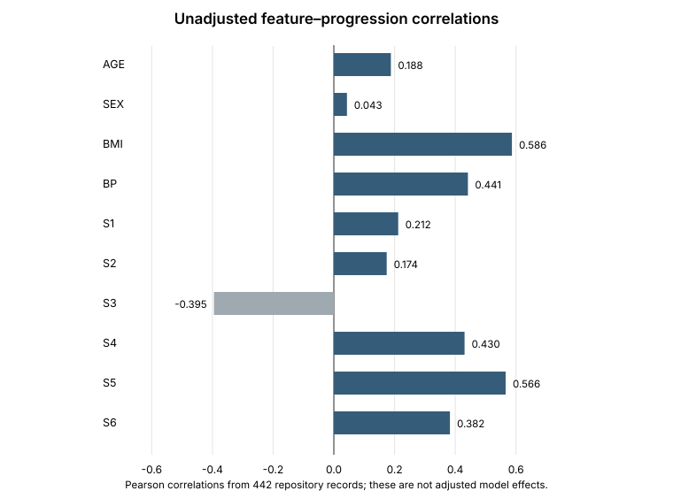
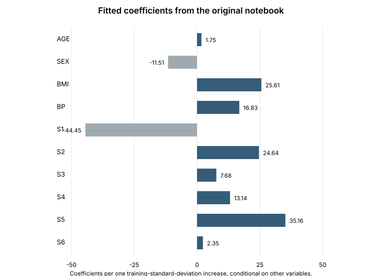

# Modelling Diabetes Progression Using Multiple Linear Regression

**An evaluation of baseline health indicators and held-out explanatory performance**

**Amogelang R. Pelo**

## Abstract

I analyse a Python project that uses multiple linear regression to estimate a quantitative diabetes-progression outcome from ten recorded baseline health indicators. The repository includes a 442-row dataset and a preserved Jupyter notebook that documents an 80/20 train/test split, training-only feature standardisation, fitting of a scikit-learn `LinearRegression` model, and evaluation with the coefficient of determination, R². The original notebook's saved output reports a held-out **R² of 0.4526** and a set of ten regression coefficients for the standardised predictors. I independently inspected the dataset and found 442 complete, distinct rows with a mean progression value of approximately 152.13 and a standard deviation of approximately 77.09. The strongest absolute *unadjusted* correlations with the recorded outcome among the ten inputs are BMI (**+0.586**), S5 (**+0.566**) and BP (**+0.441**).

The regression explains approximately 45.3% of the variation in the particular test partition relative to that test set's mean-only baseline, leaving substantial unexplained variation. The model is observational and its coefficients must not be interpreted as causal effects. I distinguish the original fitted-model outputs from supplementary calculations performed for this report and discuss the implications of feature scaling, correlated biomedical predictors and a single test split. The project demonstrates useful statistical modelling procedures but does not establish clinical validity or suitability for individual medical decisions.

**Keywords:** multiple linear regression; diabetes progression; R²; standardisation; model evaluation; predictive modelling; reproducibility.

## 1. Introduction

Regression modelling offers a way to study quantitative variation in an outcome alongside several observed explanatory variables. In a health-related dataset, this may help describe associations between baseline measurements and a later recorded outcome. Such analysis requires special care: the statistical relationship between variables does not automatically explain biological mechanisms, and a predictive score does not establish that a model is suitable for clinical use (James *et al.*, 2021).

The project examined here uses the historical diabetes dataset associated with regression examples in statistical learning. The version in the repository contains columns `AGE`, `SEX`, `BMI`, `BP`, `S1` through `S6`, and `PROGRESSION`. The corresponding scikit-learn dataset documentation describes a related 442-patient resource with ten baseline variables and a quantitative progression measure one year after baseline (scikit-learn developers, n.d.). The repository's file contains measurements on their original-looking scales rather than the prestandardised representation returned by some library interfaces; I therefore use the **repository CSV** as the numerical source for this paper.

My research question is: **How well does the submitted multivariable linear model explain held-out progression measurements, and how should its coefficients and limitations be interpreted?** I address this through a review of the notebook's method and saved outputs, supplemented by independent descriptive statistics and correlations from the included data.

The purpose is methodological, not clinical. The paper evaluates model construction and research interpretation. It does not offer diagnosis, treatment or a personalised risk assessment.

## 2. Conceptual and statistical framework

### 2.1 Multiple linear regression

Multiple linear regression expresses a continuous outcome as a function of several explanatory variables. For record `i` and ten features, the statistical model can be written as:

**Y_i = β0 + β1 X_i1 + β2 X_i2 + ... + β10 X_i10 + ε_i.**

The parameters are conventionally estimated by ordinary least squares, which minimises the sum of squared differences between observed and predicted outcomes on the training data (Wooldridge, 2020). A fitted coefficient measures an association with the outcome *conditional on the other included regressors*, under the model's functional assumptions.

A coefficient is not necessarily the causal effect of changing its feature. In observational medical data, underlying health characteristics, treatment exposure, selection mechanisms and unobserved variables may confound the association. This limitation is particularly important when reporting features as “risk factors.”

### 2.2 Feature standardisation

The original notebook applies `StandardScaler` separately to the train and test data, correctly fitting its mean and scale parameters on `X_train` and using those same parameters to transform `X_test`. The standard score is `(x − training_mean) / training_standard_deviation`, with the numerical details determined by scikit-learn's implementation (scikit-learn developers, n.d.-a).

This is an important procedural strength. Transformations fitted on the complete dataset before splitting can leak information from test records into training. In contrast, fitting the scaler only on training features preserves the principle that test-set statistics are not available during model development (scikit-learn developers, n.d.-b).

When features are standardised, fitted coefficients represent the expected change in the model's outcome for a one-training-standard-deviation change in a feature, holding the other model inputs fixed. This is not the same as a one-year increase in age, a one-unit increase in BMI or a direct physiological intervention. The intercept corresponds to predicted progression at the **training feature means**, not to an individual with zero physical measurements.

### 2.3 The coefficient of determination

The coefficient of determination for a held-out set can be expressed as **R² = 1 − SSE/SST**, where SSE is the sum of squared prediction errors and SST is the sum of squared deviations of observed outcomes from their test-set mean. An R² of 0.45 indicates better performance than a test-set mean-only prediction under this metric, but not perfect prediction.

R² alone does not reveal the distribution of errors, performance for particular subgroups, extreme prediction failures or whether the model is stable across samples. A complete predictive evaluation should also examine mean absolute error, RMSE, residual plots and uncertainty around performance (James *et al.*, 2021).

### 2.4 Correlation versus adjusted coefficients

A Pearson correlation measures the strength of a *pairwise linear association*. By contrast, a multiple-regression coefficient describes a conditional association with other included variables controlled within the fitted linear model. The two can differ in magnitude and sign when explanatory variables are correlated with one another.

This distinction matters in the diabetes dataset, where several laboratory-derived measurements are related. A predictor with positive unadjusted correlation can receive a negative multivariable coefficient when the regression allocates shared explanatory variation across correlated inputs. That does not, by itself, demonstrate a harmful or protective causal effect (Wooldridge, 2020).

## 3. Data and methods

### 3.1 Dataset and provenance

The included `diabetes_dirty.csv` has 442 rows and 11 columns: ten predictors and `PROGRESSION`. My direct checks found **no blank numeric cells** and **no exact duplicate complete rows**. Despite the word “dirty” in the filename, the supplied version does not have missing values requiring imputation for the regression.

The target variable ranges from **25** to **346** in the source file, with a mean of **152.13**, a median of **140.5** and a sample standard deviation of **77.09**. The original scikit-learn diabetes documentation describes its outcome as a quantitative disease-progression measure one year after baseline; the repository does not independently specify a clinical unit for the target, so I report values in its source measurement units (scikit-learn developers, n.d.; Pelo, n.d.-a).

| Source property | Verified value | Implication |
|:--|--:|:--|
| Total records | 442 | Small educational regression dataset |
| Predictor variables | 10 | Multivariable design |
| Missing numeric records | 0 | No imputation required in this version |
| Exact duplicate records | 0 | Sample unchanged by duplicate removal |
| Minimum / maximum progression | 25 / 346 | Wide target variation |
| Mean progression | 152.13 | Outcome centre |
| Progression standard deviation | 77.09 | Outcome dispersion |
| Train/test allocation | 80% / 20% | Source notebook split |

### 3.2 Code inspection and modelling sequence

I reviewed the published notebook and its preserved original version. Both import pandas, NumPy, Matplotlib, seaborn and scikit-learn routines. The notebook loads the CSV, checks types and missingness, drops duplicates, defines `X` by removing `PROGRESSION` and uses `PROGRESSION` as `y`.

It creates a train/test split using `test_size=0.2` and `random_state=42`, fits `StandardScaler` on training data, transforms the test data, trains `LinearRegression` on the standardised training features, predicts the test outcomes and prints R². For 442 rows, the split corresponds to **353 training observations and 89 test observations**.

The workflow avoids the common error of computing scaling statistics on the entire dataset before training. It does not, however, use cross-validation or a separate development set to compare alternative specifications, and the source does not include confidence intervals for coefficients.

### 3.3 Evidence distinction

The original notebook preserves the fitted intercept, coefficients and test R² as execution output. I reproduce those **as saved notebook results**, not as an independently rerun regression. The descriptive summary and Pearson correlations in this paper are additional calculations made directly from the CSV. Keeping these sources separate allows the reader to distinguish the author's implementation from my supplementary research analysis.

The file's resemblance to a well-known benchmark supports a plausible lineage, but I have not established every transformation between the repository's raw-scale measurements and the standardised dataset variant shipped by other libraries. Conclusions therefore refer to the supplied file and source implementation.

## 4. Findings: outcome structure and pairwise associations

### 4.1 Descriptive associations

I computed correlations between the ten input fields and `PROGRESSION` without controlling for other predictors. The results vary substantially in direction and magnitude.

| Predictor | Pearson correlation with progression |
|:--|--:|
| AGE | +0.188 |
| SEX | +0.043 |
| BMI | +0.586 |
| BP | +0.441 |
| S1 | +0.212 |
| S2 | +0.174 |
| S3 | −0.395 |
| S4 | +0.430 |
| S5 | +0.566 |
| S6 | +0.382 |

<figure class="chart wide"><figcaption>Figure 1. Unadjusted Pearson correlations independently calculated from the 442-row CSV. These are associations, not multivariable coefficients or causal estimates.</figcaption></figure>

BMI and S5 show the strongest positive pairwise correlations with the recorded target in the list, approximately 0.586 and 0.566 respectively. S3 has a negative correlation of approximately −0.395. This does not mean that changing any of these measurements would produce a corresponding change in disease progression. Pairwise analysis is a descriptive precursor to, not a replacement for, multivariable modelling.

### 4.2 Outcome variation and clinical uncertainty

The wide range from 25 to 346 illustrates why a fitted average trend does not explain individual observations perfectly. Even a model with positive R² can have substantial errors for particular records. The source dataset does not contain the historical treatment, clinical decision or sampling information necessary for definitive causal inference.

Moreover, the dataset is an educational benchmark. It is not necessarily representative of current patients, available therapies or healthcare systems. This restricts how its numerical associations should be communicated.

## 5. Saved model results

### 5.1 Reported held-out R²

The original notebook prints **`R2 Score: 0.45260276297191915`** after predicting the test partition. Under the stated metric, this means the linear model accounts for approximately **45.26%** of the variation in the observed test outcomes relative to the test-set mean baseline. Approximately 54.74% remains unexplained in this R² decomposition.

The score is not an error rate, accuracy percentage or probability of correct diagnosis. It is a regression goodness-of-fit quantity for the particular 89-record holdout. I do not infer RMSE or a confidence interval from R² alone, because those quantities depend on the actual test residuals and outcome variance.

### 5.2 Standardised coefficients

The notebook preserves an intercept of **153.7365** and the following coefficients in feature order:

| Predictor | Coefficient after training standardisation |
|:--|--:|
| AGE | +1.754 |
| SEX | −11.512 |
| BMI | +25.607 |
| BP | +16.829 |
| S1 | −44.449 |
| S2 | +24.641 |
| S3 | +7.677 |
| S4 | +13.139 |
| S5 | +35.161 |
| S6 | +2.351 |

<figure class="chart wide"><figcaption>Figure 2. Coefficients transcribed from the preserved original notebook output. Values are in outcome units per training-standard-deviation feature change, conditional on the other regressors.</figcaption></figure>

The largest-magnitude negative fitted coefficient belongs to S1, while S5 and BMI have notable positive coefficients. A larger absolute coefficient under standardisation can suggest a stronger numerical conditional association, but it does **not** establish clinical importance or causal strength, particularly where predictors are highly correlated.

### 5.3 Sign differences and correlated inputs

S1 has a **positive pairwise correlation** with the target (approximately +0.212) but a **negative multivariable coefficient** in the saved fitted model (approximately −44.449). Similarly, S3 has a negative unadjusted correlation but a positive fitted coefficient. These sign differences illustrate the distinction between marginal and adjusted relationships and suggest the relevance of dependencies among predictors.

I would not interpret the sign reversal as evidence that S1 protects against progression or that S3 causes it. An appropriate follow-on analysis would inspect a predictor correlation matrix, variance-inflation factors or other multicollinearity diagnostics and compare model stability under regularisation.

### 5.4 Model fit is not clinical utility

The reported R² around 0.45 establishes that the fitted linear model captures some variation in its held-out records. It does not demonstrate that the predictions fall within a clinically acceptable tolerance, that all population groups are served equally well or that the tool is safe to use for a patient-level decision. Such claims would require different data, clinical context and external validation.

## 6. Methodological critique and improvement priorities

### 6.1 Strengths of the implementation

The notebook separates predictors from the outcome, reserves an evaluation sample, fits feature scaling only on training data, applies the same transformation to the test set, fits a linear regression and records an out-of-sample R². These are meaningful elements of a reproducible applied modelling exercise.

I also consider the inclusion of actual-versus-predicted plotting code valuable. Such a plot can expose systematic deviations, uneven errors and extreme observations that a single summary statistic conceals. However, the preserved source does not include a machine-readable table of predicted values or numerical residual diagnostics.

### 6.2 Dependence on a single split

The 80/20 partition with a fixed random seed supports repeatability of the same split, but one test result does not establish performance stability. A different partition could change the fitted coefficients and R², especially with 442 observations and ten predictors.

I would use cross-validation within the training portion to compare specifications or assess stability and retain a separate final test set. Repeated test-set inspection while revising the model could lead to optimistic selection decisions. The purpose of validation is to estimate performance on data not used to choose the model (James *et al.*, 2021).

### 6.3 Multicollinearity and regularisation

The source includes multiple serum measures that may be strongly related. Ordinary least squares coefficients can be unstable when predictors are collinear, even if the model's overall predictions remain moderately useful. Regularised alternatives such as ridge regression or lasso could be compared to assess coefficient stability and predictive trade-offs (Efron *et al.*, 2004).

That comparison should be based on out-of-sample evidence, and any interpretation of variable importance should acknowledge dependence among predictors. I have not fitted a regularised model in this paper and therefore make no claim that one would outperform the existing regression.

### 6.4 Additional evaluation measures

A stronger study would report RMSE and mean absolute error alongside R², inspect residuals against predicted values, check for nonlinear relationships and heteroskedasticity, and assess whether outlying observations dominate the fit. If the model were proposed for a specific population, it would also require appropriate demographic and clinical validation.

I would further document the meaning and units of `PROGRESSION`, details of study inclusion, any historical measurements used to create the dataset and the extent to which its sample differs from people for whom predictions might be desired.

### 6.5 Distinguishing a statistical model from medical advice

The model predicts a numerical target in a historical dataset. It is not a diagnostic test for diabetes, a treatment recommender, a patient risk calculator or a substitute for professional assessment. A positive fitted coefficient should not be translated into advice for an individual to change a biomedical variable without domain-specific evidence and clinical review.

Maintaining this boundary is necessary for credible scientific communication. Statistical competence includes stating what the data and design cannot establish.

## 7. Reproducibility and conclusion

### 7.1 Core implementation

The following sequence captures the essential split, scaling and linear-model logic from the project:

```python
X = df.drop(columns=["PROGRESSION"])
y = df["PROGRESSION"]
X_train, X_test, y_train, y_test = train_test_split(
    X, y, test_size=0.2, random_state=42
)
scaler = StandardScaler()
X_train_scaled = scaler.fit_transform(X_train)
X_test_scaled = scaler.transform(X_test)
model = LinearRegression().fit(X_train_scaled, y_train)
test_r2 = r2_score(y_test, model.predict(X_test_scaled))
```

For rigorous replication, a reader should use the exact CSV in the repository, record package versions and preserve any cleaning operations before the split. The reported test R² and coefficients can then be checked against the original notebook's saved output.

### 7.2 Limitations

The analysis uses one small, historical, observational dataset. The fitted coefficients and R² are preserved notebook results rather than independently retrained results. My additional statistics describe the repository's raw observations. No causal estimation, prospective clinical testing, external validation or distributional uncertainty assessment is included. These limitations restrict inference, even though the source workflow is technically useful.

### 7.3 Conclusion

I find that the project demonstrates a coherent multiple linear regression pipeline with an appropriate separation of training and test scaling. Its preserved test R² of approximately **0.4526** indicates meaningful but incomplete explanatory performance in the chosen held-out partition. Descriptive analysis of the 442 records shows substantial variation in the target and differing relationships between progression and recorded features.

The greatest interpretive risk is treating coefficients or a single R² value as clinical evidence or causal effects. I would present the project as an applied statistical-learning exercise, improved in future by cross-validation, residual diagnostics, feature-dependence analysis and clearly documented outcome meaning. Its scientific value lies in a transparent evaluation of both the model and the limits of its evidence.

## References

Efron, B., Hastie, T., Johnstone, I. and Tibshirani, R. (2004) ‘Least angle regression’, *The Annals of Statistics*, 32(2), pp. 407–499.

James, G., Witten, D., Hastie, T. and Tibshirani, R. (2021) *An Introduction to Statistical Learning: With Applications in R*. 2nd edn. New York: Springer.

Pelo, A.R. (n.d.-a) *Diabetes multiple regression: portfolio notebook*. GitHub portfolio. Available at: https://github.com/amopelo-southafrica/Mathematics-and-Statistics/blob/main/modelling-diabetes-progression/diabetes_multiple_regression.ipynb.

Pelo, A.R. (n.d.-b) *Diabetes regression: original notebook*. GitHub portfolio. Available at: https://github.com/amopelo-southafrica/Mathematics-and-Statistics/blob/main/modelling-diabetes-progression/diabetes_regression_original.ipynb.

Pelo, A.R. (n.d.-c) *diabetes_dirty.csv: project dataset*. GitHub portfolio. Available at: https://github.com/amopelo-southafrica/Mathematics-and-Statistics/blob/main/modelling-diabetes-progression/diabetes_dirty.csv.

scikit-learn developers (n.d.) *The diabetes dataset*. scikit-learn user guide. Available at: https://scikit-learn.org/stable/datasets/toy_dataset.html.

scikit-learn developers (n.d.-a) *StandardScaler*. scikit-learn documentation. Available at: https://scikit-learn.org/stable/modules/generated/sklearn.preprocessing.StandardScaler.html.

scikit-learn developers (n.d.-b) *Common pitfalls and recommended practices*. scikit-learn documentation. Available at: https://scikit-learn.org/stable/common_pitfalls.html.

Wooldridge, J.M. (2020) *Introductory Econometrics: A Modern Approach*. 7th edn. Boston: Cengage.
