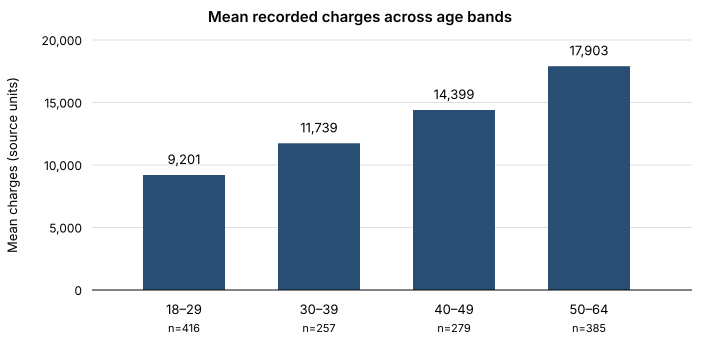

# Age and Medical Insurance Charges

**A single-predictor linear regression study**

**Amogelang R. Pelo**

## Abstract

I examine the association between age and the `charges` field in a medical insurance dataset using ordinary least squares (OLS) linear regression. The underlying project notebook imports `insurance.csv`, removes duplicated records, plots age against charges and fits a scikit-learn `LinearRegression` model. I independently checked the supplied data and reproduced the corresponding linear fit. Of 1,338 original rows, one exact duplicate was detected, leaving 1,337 distinct observations. The estimated model is `charges = 3,190.02 + 257.23 × age`. Its in-sample coefficient of determination is **R² = 0.0890**, indicating that age alone explains approximately 8.9% of the observed variation in charges. The in-sample root mean square error is approximately **11,554.65** in the unspecified units of the source field.

The relationship is positive in the supplied observations, but its low explanatory power limits individual prediction. Because the dataset's original producer, observation years, charge units and sampling process are not established by the project files, the analysis is descriptive, not evidence of a current insurance market or a causal effect of age. I distinguish what the original notebook implements from my additional validation and statistical calculations.

**Keywords:** linear regression; insurance charges; age; ordinary least squares; prediction error; reproducibility.

## 1. Introduction

An insurance-charge dataset provides a practical setting for evaluating the distinction between association, explanation and prediction. Medical and insurance-related charges can vary substantially between individuals. Age is one plausible associated variable, but charges may also reflect smoking, body mass index, health status, benefit design and other characteristics. A univariate model is useful for introducing estimation and interpretation precisely because it forces the analyst to confront what a one-variable explanation omits (James *et al.*, 2021).

The source project asks whether a straight-line model captures a measurable relationship between a person's age and the field named `charges`. The notebook loads a CSV file using pandas, conducts basic exploration, constructs a scatterplot and estimates a regression using scikit-learn. It then plots predicted charges over the observed observations (Pelo, n.d.).

My research question is: **How much of the variation in the supplied insurance charges is associated with age under a single-predictor linear model, and what are the limits of interpreting that fitted relationship?** I answer this by inspecting the original project, checking the accompanying data and calculating the fitted coefficients, residual error and explained variance directly from the records.

This paper does not treat the source variable `charges` as equivalent to insurance premiums. The file does not establish whether those amounts are premiums, claims, billed costs or another measure. I therefore retain the original variable name and avoid naming its unknown currency or measurement year.

## 2. Conceptual and statistical framework

### 2.1 Ordinary least squares regression

Simple linear regression expresses the conditional mean of an outcome as an intercept plus one explanatory variable and an error term. For record `i`, the statistical model can be written as `charges_i = β0 + β1 age_i + ε_i`. OLS chooses the intercept and slope to minimise the sum of squared residuals between observed outcomes and fitted values (Wooldridge, 2020).

In a model with only age, the slope measures the change in predicted charges associated with one additional year of age. It does not, on its own, identify a causal effect. Age may be correlated with omitted factors, and a regression coefficient need not represent the effect of changing the explanatory variable while holding every confounding determinant constant.

OLS is valuable as an interpretable baseline. It produces an equation that can be audited, visualised and compared with more elaborate specifications. A baseline should nevertheless be evaluated by residual variation, outliers and prediction performance rather than by the appeal of a visually upward-sloping line (James *et al.*, 2021).

### 2.2 Interpretation of model fit

The coefficient of determination, R², is one minus the ratio of residual sum of squares to total sum of squares when calculated using the training data and an intercept. It describes the proportion of observed outcome variation accounted for by the fitted model. An R² close to zero indicates limited explanatory power even when a positive slope is visible (Pedregosa *et al.*, 2011).

Root mean square error (RMSE) expresses the typical squared-error scale in units of the response. Both R² and RMSE require context. Here the source dataset does not define the monetary unit, so absolute values are reported as source units only. Moreover, in-sample error is optimistic about deployment: the notebook does not reserve a holdout set for out-of-sample evaluation.

### 2.3 Data preparation and duplicate records

The source code checks missing values and drops exact duplicate rows before fitting the model. This is a defensible data-cleaning choice where repeated records could otherwise exert unintended additional weight. But duplicate removal must be described because it changes the effective sample. There is no evidence that records with matching characteristics are truly the same insured person; an exact duplicated row is identifiable, while real-world record identity cannot be established from the supplied CSV.

The original notebook includes exploratory data inspection, yet it does not report a hypothesis test, confidence interval, heteroskedasticity diagnostic or cross-validated error. I therefore refrain from claiming statistical significance or external predictive accuracy.

## 3. Dataset, provenance and research design

### 3.1 Source file and variables

The repository includes `insurance.csv` with seven columns: `age`, `sex`, `bmi`, `children`, `smoker`, `region` and `charges`. The presence of additional variables should not be confused with their use by the source notebook: **the regression has only `age` as its predictor**. My checks found 1,338 rows before cleaning, 1,337 unique complete rows after dropping one exact duplicate and no missing numerical values in `age` or `charges` (Dataset accompanying Pelo, n.d.).

| Dataset property | Observed value | Implication |
|:--|--:|:--|
| Initial rows | 1,338 | Rows in source CSV |
| Exact duplicated rows | 1 | Removed for reproduced fit |
| Final observations | 1,337 | Modelled sample |
| Minimum and maximum age | 18–64 | Observed predictor domain |
| Mean age | 39.21 | Descriptive sample centre |
| Mean `charges` | 13,270.42 | Source units, not verified currency |
| Minimum and maximum `charges` | 1,121.87–63,770.43 | Substantial outcome dispersion |

### 3.2 Replication steps

I followed the supplied notebook's essential sequence: load the CSV; inspect columns, missingness and duplicates; remove exact duplicates; choose `age` as `X` and `charges` as `y`; fit an ordinary least squares regression; and compare the fitted line with a scatterplot of observed charges. The source uses pandas, Matplotlib, seaborn and scikit-learn's `LinearRegression` estimator (Pelo, n.d.; Pedregosa *et al.*, 2011).

For the additional numerical checks in this paper, I calculated the intercept and slope from sample means and sums of squares. I then derived R² and RMSE from the fitted residuals. These calculations are **supplementary to the original notebook**; the notebook displays the regression fit but does not provide a complete published error table.

### 3.3 Analytical scope and assumptions

The design is observational, cross-sectional and descriptive. There is no documented sampling frame, random assignment or temporal ordering adequate for a causal claim. The fitted line assumes linearity in age, while the residuals need not be identically distributed and may exhibit increasing variance across the response range. I did not convert the findings into risk scores for particular insured individuals.

An additional limitation is data provenance. The repository contains the records but not verifiable documentation of the original collecting institution, observation years, currency or population. This prevents me from making claims about contemporary healthcare costs in any country.

## 4. Regression results

### 4.1 Fitted relationship

The reproduced regression equation is:

**Predicted `charges` = 3,190.02 + 257.23 × age**

This means that the fitted value increases by approximately 257.23 source units for a one-year difference in age. The intercept of 3,190.02 is the predicted value at age zero; because the observed sample begins at age 18, the intercept is a mathematical extrapolation rather than an empirically supported newborn charge.

| Statistic | Reproduced value | Interpretation |
|:--|--:|:--|
| Intercept | 3,190.02 | Extrapolated fitted value at age zero |
| Age coefficient | +257.23 | Positive within-sample association per year |
| Pearson correlation | +0.2983 | Weak-to-moderate positive linear association |
| In-sample R² | 0.08899 | Approximately 8.9% explained variance |
| In-sample RMSE | 11,554.65 | Large residual error in source units |
| Fitted observations | 1,337 | Complete, deduplicated sample |

These values are consistent with a positive aggregate relationship but also substantial unexplained outcome dispersion. In particular, I do not infer that a charge prediction for one individual can be trusted to within 257 units simply because the age coefficient has that magnitude.

### 4.2 Group-level comparison

To make the age pattern easier to inspect, I computed descriptive mean charges for four non-overlapping age bands. These bands are an **additional summary** and were not part of the original notebook's regression formula.

| Age band | Records | Mean `charges` |
|:--|--:|--:|
| 18–29 | 416 | 9,200.62 |
| 30–39 | 257 | 11,738.78 |
| 40–49 | 279 | 14,399.20 |
| 50–64 | 385 | 17,902.55 |

<figure class="chart wide"><figcaption>Figure 1. Mean recorded charges by age band, calculated from the 1,337 deduplicated observations. Amount units are not documented in the source file.</figcaption></figure>

The band means increase with age, which is consistent with the positive OLS slope. The means are not adjusted for smoking, body mass index or other available characteristics, however. Differences between groups can therefore reflect a combination of age association and changes in the composition of each group.

### 4.3 Scale of the residual variation

I obtain an in-sample RMSE of approximately 11,555 against a sample mean charge of approximately 13,270. This level of error is material. It shows why the model is primarily a baseline demonstration of linear regression rather than a sufficiently reliable stand-alone pricing or underwriting system.

The slope, intercept and R² describe the best-fitting straight line for these records. They do not prove that the conditional mean is linear across every age, nor do they establish how the model will perform on unseen observations. A high charge can coexist with a low age, and similar ages can have widely different charges. Such deviations cannot be understood through a single-variable model alone.

## 5. Critical discussion

### 5.1 Explanation is not prediction

The contrast between a clearly positive slope and R² below 0.10 is the main result. A visible trend can be real within the dataset while still explaining only a small fraction of the observed heterogeneity. This is not a contradiction; it is the distinction between detecting association and capturing enough structure for useful individual prediction (James *et al.*, 2021).

If the aim is educational, the model succeeds: it illustrates data preparation, the OLS criterion, estimation and graphical interpretation. If the aim is operational prediction, it is insufficient without an honest holdout evaluation and consideration of appropriate explanatory factors.

### 5.2 Omitted predictors and ethical questions

The dataset includes `smoker`, `bmi`, `children`, `region` and `sex`, but the original regression excludes them by design. Omitted-variable bias can arise when excluded covariates both influence charges and correlate with age. Therefore I would not interpret the age coefficient as the charge increase caused by ageing (Wooldridge, 2020).

Medical and insurance data also raise fairness and governance concerns. A model used to make real decisions would need clear definition of its target, authority to process the data, consideration of sensitive variables and an evaluation of unequal errors across relevant groups. This notebook is not a deployed or validated decision model.

### 5.3 Measurement and generalisability

The source field name alone does not establish that `charges` represents premiums, claims paid or healthcare expenditure. The amount units and observation dates are unverified. Even a well-fitting regression would not resolve those ambiguities. Results are consequently described as properties of the supplied file and should not be transferred to South African, American or other insurance markets without verified documentation.

The removal of one exact duplicate has very little impact on sample size, but it illustrates a general reproducibility principle: a report must state the observation count after cleaning, not only the number of lines in the original CSV.

### 5.4 Evaluation improvements

A stronger next-stage study would predefine a train/test split, fit all preprocessing only on the training partition, compare the simple linear fit with multivariable regression and examine residual patterns. The analyst should also evaluate mean absolute error, out-of-sample RMSE, calibration and error distributions across important subgroups. Cross-validation could help quantify how sensitive the results are to the sample split.

I would additionally test whether an age-only linear relationship adequately represents the data or whether nonlinear terms and interactions improve predictive value. Such extensions should be judged by out-of-sample evidence, not solely by a higher training R².

## 6. Methodological limitations and reproducibility

### 6.1 What the original notebook establishes

The original notebook establishes an implemented sequence, not a validated forecasting tool. It reads a dataset, inspects and deduplicates rows, uses a single age predictor, fits a regression model and visualises the fitted line. It does **not** supply a distinct held-out evaluation dataset or demonstrate stability across time or populations.

My reported coefficient, error metrics and age-band summaries are independent calculations using the repository's associated CSV. Because they are follow-on calculations, they should not be represented as original notebook outputs when presenting the portfolio.

### 6.2 Reproduction protocol

The core sequence is reproducible using pandas and scikit-learn:

```python
df = pd.read_csv("insurance.csv").drop_duplicates()
X = df[["age"]]
y = df["charges"]
model = LinearRegression().fit(X, y)
predicted = model.predict(X)
```

This reproduces the basic in-sample model. A subsequent version should pin package versions, document the true dataset source and include a deterministic holdout split before reporting any genuine predictive assessment. Reproducibility of a fitted number is not the same as external validity or scientific generalisability.

## 7. Conclusion

I find a positive association between age and the source dataset's recorded insurance charges. After cleaning, the fitted line has an age coefficient of approximately 257.23 and an in-sample R² of approximately 0.089. The model therefore identifies an interpretable pattern while leaving most observed variation unexplained. The high residual error further cautions against using age alone for individual-level prediction.

I regard this project as an effective demonstration of basic regression modelling and a useful starting point for more rigorous analysis. Its value is in the transparent steps and the limits they reveal, not in claiming that a single variable can explain or price individual medical costs. Future work should establish data provenance, add substantive predictors, assess out-of-sample performance and critically evaluate the implications of using the model in decision contexts.

## References

Dataset accompanying Pelo, A.R. (n.d.) *insurance.csv*. GitHub project dataset. Available at: https://github.com/amopelo-southafrica/Mathematics-and-Statistics/blob/main/predicting-insurance-charges/insurance.csv. Original producer, observation period and units are not documented in the project files.

James, G., Witten, D., Hastie, T. and Tibshirani, R. (2021) *An Introduction to Statistical Learning: With Applications in R*. 2nd edn. New York: Springer.

Pedregosa, F. *et al.* (2011) ‘Scikit-learn: Machine learning in Python’, *Journal of Machine Learning Research*, 12, pp. 2825–2830. Available at: https://jmlr.org/papers/v12/pedregosa11a.html.

Pelo, A.R. (n.d.) *Insurance cost regression: original Jupyter notebook*. GitHub portfolio. Available at: https://github.com/amopelo-southafrica/Mathematics-and-Statistics/blob/main/predicting-insurance-charges/insurance_cost_regression.ipynb.

Wooldridge, J.M. (2020) *Introductory Econometrics: A Modern Approach*. 7th edn. Boston: Cengage.
